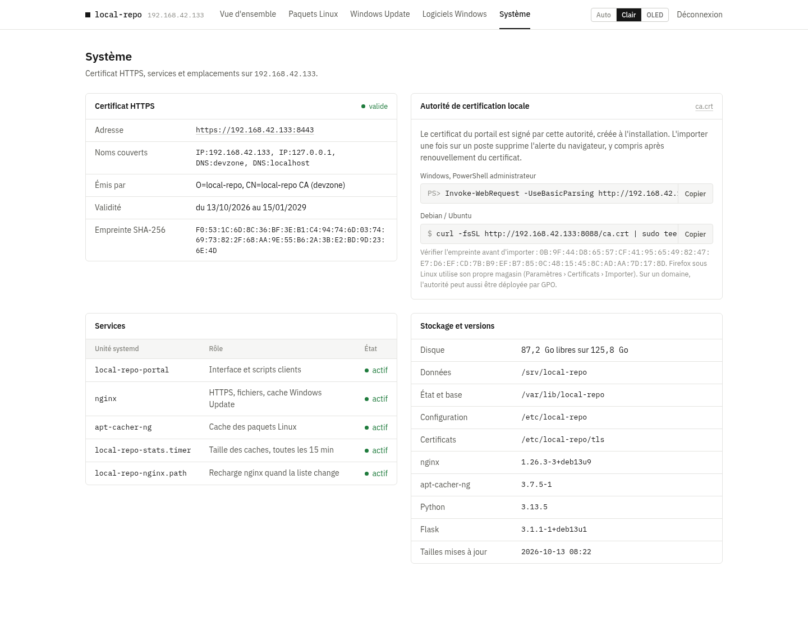

# local-repo

Dépôt local pour un réseau domestique ou de PME, installé en une commande sur Debian / Ubuntu, **sans Docker** :

- **Paquets Linux** : cache [apt-cacher-ng](https://www.unix-ag.uni-kl.de/~bloch/acng/) pour Debian/Ubuntu, plus un dépôt APT local signé pour vos propres `.deb`.
- **Mises à jour Windows** : cache nginx des téléchargements Windows Update (même principe que [lancache](https://lancache.net)).
- **Logiciels Windows** : catalogue d'installeurs (`exe`, `msi`, `msu`, `ps1`) installables en silence par une commande PowerShell.
- **Portail web** en HTTPS (certificat auto-signé par une autorité locale) pour tout ajouter, suivre et copier
  les commandes, en thème **clair** ou **OLED** (noir pur).

| Thème OLED | Thème clair |
|---|---|
|  |  |
|  |  |



## Installation

```bash
git clone https://github.com/ShaNouhAr/local-repo.git
cd local-repo
sudo ./install.sh
```

À la fin, le script affiche l'adresse du portail (`https://<ip>:8443`), l'empreinte de l'autorité de certification et le mot de passe généré
(aussi gardé dans `/etc/local-repo/admin-password`).

Options utiles :

| Option | Effet |
|---|---|
| `--port 8088` | port HTTP des postes clients (dépôt, installeurs, scripts) |
| `--https-port 8443` | port HTTPS de l'interface |
| `--tls-cert F --tls-key F` | utiliser son propre certificat au lieu de l'autorité locale |
| `--host 192.168.1.10` | adresse annoncée aux clients (détectée sinon) |
| `--data /srv/local-repo` | dossier des données et des caches |
| `--wu-cache-size 100g` | taille max du cache Windows Update (défaut : moitié de l'espace libre, 200g max) |
| `--password MDP` | définit / change le mot de passe du portail |
| `--no-wu` | sans cache Windows Update (laisse les ports 80 et 443 libres) |

Le script est relançable : il sert aussi à mettre à jour (`git pull && sudo ./install.sh`) ou à changer une option.
Les réglages sont gardés dans `/etc/local-repo/local-repo.conf`.

### HTTPS

L'interface est servie en HTTPS sur le port 8443. L'installation crée une autorité de certification locale
(`/etc/local-repo/tls/ca.crt`, valable 10 ans) qui signe le certificat du serveur (825 jours, renouvelé
automatiquement par `install.sh` s'il expire bientôt ou si l'IP change). Le navigateur affiche une alerte
tant que l'autorité n'est pas importée ; la page **Système** du portail donne son empreinte et les commandes :

```powershell
# Windows (PowerShell administrateur)
Invoke-WebRequest -UseBasicParsing http://<ip>:8088/ca.crt -OutFile $env:TEMP\local-repo-ca.crt
Import-Certificate -FilePath $env:TEMP\local-repo-ca.crt -CertStoreLocation Cert:\LocalMachine\Root
```

```bash
# Debian / Ubuntu
curl -fsSL http://<ip>:8088/ca.crt | sudo tee /usr/local/share/ca-certificates/local-repo.crt >/dev/null && sudo update-ca-certificates
```

Sur un domaine Active Directory, l'autorité peut aussi être déployée par GPO.

Avec `--tls-cert` / `--tls-key`, votre certificat est utilisé tel quel et conservé aux relances ; pour revenir
à l'autorité locale, supprimez `/etc/local-repo/tls/custom` puis relancez `install.sh`.

Le port HTTP 8088 reste ouvert pour les postes clients (`apt`, `irm`) qui ne font pas forcément confiance
à l'autorité : il ne sert que le dépôt APT (signé GPG), les installeurs (vérifiés par SHA256 avant
installation), les scripts clients et `ca.crt`. Toute autre adresse redirige vers HTTPS.

### Désinstallation

```bash
sudo /opt/local-repo/remove.sh           # garde les données (logiciels, .deb, caches, clé APT)
sudo /opt/local-repo/remove.sh --purge   # efface tout
```

Seuls les paquets installés par `install.sh` sont retirés ; ceux qui étaient déjà présents restent.

## Utilisation

### Postes Linux (Debian / Ubuntu)

```bash
curl -fsSL http://<ip>:8088/linux/setup.sh | sudo sh
```

Sur un système minimal sans `curl` : `wget -qO- http://<ip>:8088/linux/setup.sh | sudo sh`.

Le poste passe par le cache apt-cacher-ng et voit le dépôt local. Variantes :
`| sudo sh -s -- --no-proxy` (dépôt local seul), `| sudo sh -s -- --remove` (annuler).

Les `.deb` ajoutés depuis le portail (fichier ou URL) s'installent ensuite avec `sudo apt install <paquet>`.
Les dépôts HTTPS (Docker, etc.) restent en accès direct ; seuls les dépôts HTTP passent par le cache.

### Logiciels Windows

Dans le portail, **Logiciels Windows** → ajouter un logiciel par URL (téléchargé par le serveur) ou par envoi de fichier.
Cochez ensuite un ou plusieurs logiciels et copiez la commande, à lancer dans un PowerShell **administrateur** :

```powershell
irm 'http://<ip>:8088/win/i/7-zip,vlc' | iex
```

Les guillemets sont nécessaires : sans eux, PowerShell lit la virgule comme un tableau.
Le script télécharge depuis le serveur, vérifie le SHA256 et installe en silence :

| Type | Commande lancée | Arguments par défaut |
|---|---|---|
| msi | `msiexec /i fichier.msi <args>` | `/qn /norestart` |
| msu | `wusa fichier.msu <args>` | `/quiet /norestart` |
| exe | `fichier.exe <args>` | à renseigner (`/S`, `/silent`, `/quiet`… selon l'éditeur) |
| ps1 | `powershell -File fichier.ps1 <args>` | — |
| fichier | copie dans `C:\Users\Public\Downloads` | — |

**Actualiser** retélécharge depuis l'URL source : pratique avec les liens « dernière version ».
Le type (exe, msi…) est déduit du fichier réellement reçu, même si le lien n'a pas d'extension.

Chaque installeur a 30 minutes pour se terminer (`$env:LR_TIMEOUT = 600` avant la commande pour changer) :
un `.exe` lancé sans argument silencieux attend un clic et serait sinon bloqué indéfiniment.
Le portail signale ces logiciels. Une mise à jour `.msu` déjà installée ou non applicable est indiquée comme telle.

### Windows Update

Le cache répond sur le port 80 à la place des serveurs Microsoft. Pour que les postes l'utilisent,
le DNS du réseau doit renvoyer l'IP du serveur pour les domaines Windows Update
(par défaut `windowsupdate.com` et `dl.delivery.mp.microsoft.com`, avec leurs sous-domaines).

Avec un DNS Active Directory : page **Windows Update** du portail → télécharger le script
`local-repo-dns.ps1`, puis sur le contrôleur de domaine :

```powershell
.\local-repo-dns.ps1           # crée les zones
.\local-repo-dns.ps1 -Remove   # retour arrière
```

Avec un autre DNS (Pi-hole, AdGuard, dnsmasq, box…), créez l'équivalent : `windowsupdate.com` et
`*.windowsupdate.com` → IP du serveur, idem pour `dl.delivery.mp.microsoft.com`.

Le trafic HTTPS vers ces domaines est relayé tel quel (port 443, sans déchiffrement) ; seuls les
téléchargements HTTP sont mis en cache, ce qui couvre l'essentiel du volume des mises à jour.
Le premier poste télécharge depuis Internet, les suivants sont servis en local.

Seuls les fichiers immuables (nom contenant une empreinte ou un identifiant unique, comme les paquets de
mise à jour) sont gardés en cache ; les fichiers qui changent, comme les listes de certificats
(`authrootstl.cab`), passent toujours chez Microsoft. Les requêtes partielles (Delivery Optimization) sont gérées.

Seuls les domaines de la liste sont acceptés, sur 80 comme sur 443 : le reste est refusé. Une modification de
la liste dans le portail est appliquée à nginx automatiquement (service `local-repo-nginx.path`).

## Fonctionnement

| Élément | Où | Port |
|---|---|---|
| Portail (Flask + gunicorn, service `local-repo-portal`) | `/opt/local-repo` | 8089 (local) |
| nginx : interface HTTPS | `/etc/nginx/sites-available/local-repo-portal.conf` | 8443 |
| nginx : postes clients (`/apt/`, `/win/files/`, scripts, `ca.crt`) | même fichier | 8088 |
| Certificats (autorité locale, serveur) | `/etc/local-repo/tls` | — |
| nginx : cache Windows Update | `/etc/nginx/sites-available/local-repo-wucache.conf` | 80 |
| nginx : relais HTTPS (SNI) | `/etc/nginx/modules-enabled/99-local-repo-stream.conf` | 443 |
| apt-cacher-ng | `/var/cache/apt-cacher-ng` | 3142 |
| Données (dépôt APT, logiciels, cache WU) | `/srv/local-repo` | — |
| Base, clé GPG du dépôt, statistiques | `/var/lib/local-repo` | — |

Tout vient des dépôts officiels Debian (`nginx`, `apt-cacher-ng`, `python3-flask`, `gunicorn`, `gnupg`) :
les mises à jour de sécurité arrivent avec `apt upgrade`.

Journaux : `journalctl -u local-repo-portal`, `/var/log/nginx/local-repo-*.log`,
sortie d'apt de la dernière installation dans `/var/log/local-repo-install.log`.

## Sécurité

- Pensé pour un **réseau local de confiance** : n'exposez pas ces ports sur Internet.
  Le cache Windows Update (80/443) ne relaie que les domaines de sa liste.
- L'interface d'administration est en HTTPS, protégée par mot de passe (cookie de session `Secure`,
  jeton CSRF, en-têtes anti-clickjacking).
  Les téléchargements (`/apt/`, `/win/files/`, scripts d'installation) sont publics sur le réseau.
- Le dépôt APT local est signé par une clé générée à l'installation.
- Le portail tourne sous un utilisateur dédié (`localrepo`) avec un service systemd restreint.

## Portail

- Thème automatique (suit le système), clair ou OLED : sélecteur dans la barre du haut, mémorisé par navigateur.
- Indicateurs et journal Windows Update actualisés en direct ; progression des téléchargements et des envois.
- Envoi de fichiers par glisser-déposer, filtres, sélection multiple des logiciels avec commande prête à copier.
- Page **Système** : certificat HTTPS, état des unités systemd, versions, emplacements.
- Aucune ressource externe : polices et scripts sont servis par le serveur.

## Licence

MIT. Les polices [IBM Plex](https://github.com/IBM/plex) sont distribuées sous licence SIL OFL 1.1
(`portal/static/fonts/IBMPlex-LICENSE.txt`).
