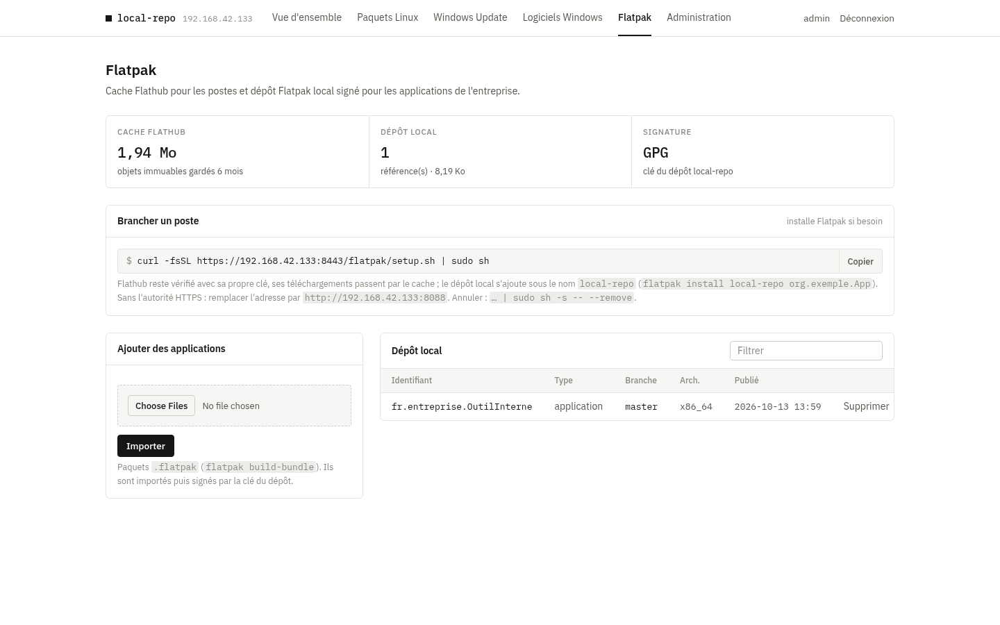

# local-repo

[](https://github.com/ShaNouhAr/local-repo/actions/workflows/ci.yml)

Serveur de dépôts et de caches pour un réseau d'entreprise, installé en une commande sur Debian ou Ubuntu,
**sans Docker** :

- **Paquets Linux** : cache [apt-cacher-ng](https://www.unix-ag.uni-kl.de/~bloch/acng/) pour Debian / Ubuntu
  et dépôts APT signés pour vos propres `.deb`, séparés par distribution et version.
- **Windows Update** : cache des téléchargements de mises à jour (même principe que [lancache](https://lancache.net)).
- **Logiciels Windows** : catalogue d'installeurs (`exe`, `msi`, `msu`, `ps1`) installés en silence par PowerShell.
- **Flatpak** : cache Flathub et dépôt Flatpak local signé pour les applications de l'entreprise.
- **Portail web** en HTTPS : comptes nommés, journal d'audit, supervision, sauvegardes ; thème clair ou OLED.

| | |
|---|---|
|  |  |
|  |  |

## Installation

```bash
git clone https://github.com/ShaNouhAr/local-repo.git
cd local-repo
sudo ./install.sh
```

Debian 12 / 13, Ubuntu 22.04 / 24.04 / 26.04 (validations serveur en amd64). L'installation affiche l'adresse de l'interface
(`https://<ip>:8443`), l'empreinte de l'autorité de certification et le mot de passe initial du compte
`admin` (à changer à la première connexion). Le script est relançable : il sert aussi à mettre à jour
(`git pull && sudo ./install.sh`) et à reconfigurer.

Options principales (toutes : `sudo ./install.sh --help`) :

| Option | Effet |
|---|---|
| `--allow "CIDR …"` | réseaux autorisés pour les postes (défaut : réseaux privés) |
| `--admin-allow "CIDR …"` | réseaux autorisés pour l'interface (défaut : comme `--allow`) |
| `--proxy http://hôte:port` | proxy d'entreprise pour sortir sur Internet |
| `--no-http` | HTTPS seul (autorité déjà déployée sur les postes) |
| `--no-wu`, `--no-flatpak` | sans cache Windows Update, sans Flatpak |
| `--tls-cert F --tls-key F` | certificat d'entreprise au lieu de l'autorité locale |
| `--backup-keep N` | sauvegardes quotidiennes gardées (défaut 3, 0 = aucune) |

Déploiement en entreprise (réseau, GPO, proxy, sauvegardes, supervision, dépannage) :
**[guide d'exploitation](docs/EXPLOITATION.md)**.

## Brancher les postes

Dans **Linux › Paquets APT**, créez d'abord les dépôts nécessaires : distribution, numéro de version
facultatif et nom de code (par exemple `debian/trixie` ou `ubuntu/noble`). Une future version s'ajoute
depuis cette page, sans modifier le code. Chaque dépôt a ses propres fichiers et index signés.

Les postes font confiance à l'autorité locale (`ca.crt`, déployée par GPO ou depuis la page
*Administration › Système*), puis :

```bash
# Debian / Ubuntu : dépôt local + cache APT
curl -fsSL https://<ip>:8443/linux/setup.sh | sudo sh
# … premier branchement, autorité pas encore importée (affiche son empreinte)
curl -fsSL http://<ip>:8088/linux/setup.sh | sudo sh -s -- --trust-ca
# Cache seul, sans dépôt local
curl -fsSL https://<ip>:8443/linux/setup.sh | sudo sh -s -- --cache-only

# Flatpak : Flathub via le cache + dépôt local « local-repo »
curl -fsSL https://<ip>:8443/flatpak/setup.sh | sudo sh
```

```powershell
# Windows, PowerShell administrateur : installe un ou plusieurs logiciels du catalogue
irm 'https://<ip>:8443/win/i/7-zip,vlc' | iex
```

Le script Windows vérifie le SHA-256 de chaque installeur, laisse 30 minutes à chacun (`$env:LR_TIMEOUT`)
et reconnaît les codes « redémarrage requis », « déjà installé » et « non applicable ».

Pour Windows Update, le DNS doit renvoyer l'IP du serveur pour les domaines de mise à jour : la page
*Windows Update* fournit le script pour un DNS Active Directory.

Le script Linux lit `/etc/os-release` et sélectionne le dépôt correspondant au poste. Si ce dépôt
n'existe pas, il s'arrête avant de remplacer la configuration. Les dérivées peuvent choisir explicitement
`--distribution ubuntu --suite noble`. Les sources APT sont au format deb822 (`local-repo.sources`).

**Mise à jour depuis 1.0.0** : l'ancien dépôt `/apt/` et les postes déjà branchés restent fonctionnels.
L'action *Copier vers un autre dépôt* conserve les originaux. Vérifiez la compatibilité de chaque paquet,
puis relancez le script sur les postes. `--legacy` permet de conserver explicitement l'ancien dépôt partagé.

## Administration

```bash
sudo local-repo-user list | add NOM [admin|viewer] | passwd NOM   # comptes (accès perdu : passwd admin)
sudo local-repo-backup create | list | restore ARCHIVE             # sauvegardes
sudo /opt/local-repo/remove.sh [--purge]                           # désinstallation
```

Supervision : `https://<ip>:8443/metrics` (Prometheus) et `/healthz`.

## Architecture

| Élément | Emplacement | Port |
|---|---|---|
| Portail (Flask + gunicorn, unité `local-repo-portal`, confinée) | `/opt/local-repo` | 8089, local |
| nginx : interface et fichiers des postes (HTTPS) | `/etc/nginx/sites-available/local-repo-portal.conf` | 8443 |
| nginx : amorçage HTTP (optionnel) | même fichier | 8088 |
| nginx : cache Windows Update, relais HTTPS (SNI) | `local-repo-wucache.conf`, `modules-enabled/99-local-repo-stream.conf` | 80, 443 |
| apt-cacher-ng | `/var/cache/apt-cacher-ng` | 3142 |
| Données : dépôts, catalogue, caches | `/srv/local-repo` | — |
| Base, clé GPG, statistiques | `/var/lib/local-repo` | — |
| Configuration, autorité et certificats | `/etc/local-repo` | — |

Tout vient des dépôts officiels Debian / Ubuntu (`nginx`, `apt-cacher-ng`, `python3-flask`, `gunicorn`,
`gnupg`, `flatpak`, `ostree`) : les correctifs de sécurité arrivent avec `apt upgrade`.

## Sécurité

Comptes à rôles, HTTPS, CSP stricte, CSRF, blocage des tentatives, audit, filtrage réseau, processus
confiné, dépôts signés. Détails et limites : [SECURITY.md](SECURITY.md).

## Développement

```bash
sudo apt-get install python3-flask apt-utils gnupg
python3 -m unittest discover -s tests          # portail, isolation APT et signatures réelles
tests/e2e.sh                                   # bout en bout, sur une machine JETABLE uniquement
tests/vm-e2e.sh debian-13                       # VM jetable ; nécessite QEMU, genisoimage, SSH et curl
```

Le workflow CI lance `shellcheck`, `pyflakes` puis une VM QEMU pour chaque entrée de
[`tests/platforms.json`](tests/platforms.json) : Debian 12/13 et Ubuntu 22.04/24.04/26.04.
Il fonctionne à chaque PR/push, chaque semaine et à la demande, avec conservation des journaux.
Les images officielles sont vérifiées par leur empreinte avant le démarrage ; Docker n'est pas utilisé.
Les tests couvrent la mise à jour depuis 1.0.0 sur les systèmes déjà pris en charge, la détection du poste,
l'isolation des paquets, Flatpak, une restauration et la désinstallation. Le workflow est publié et actif sur GitHub.
Historique : [CHANGELOG.md](CHANGELOG.md).

## Licence

MIT. Polices [IBM Plex](https://github.com/IBM/plex) sous licence SIL OFL 1.1
(`portal/static/fonts/IBMPlex-LICENSE.txt`).
