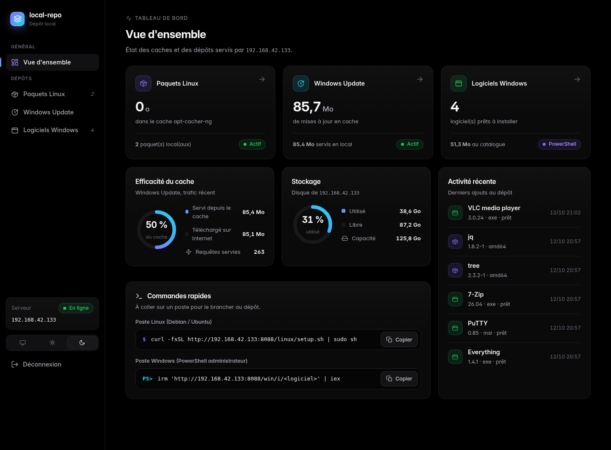
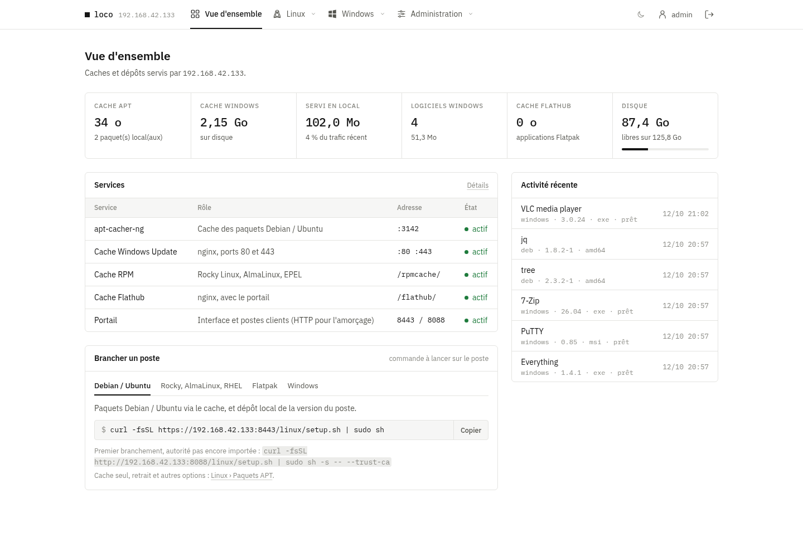
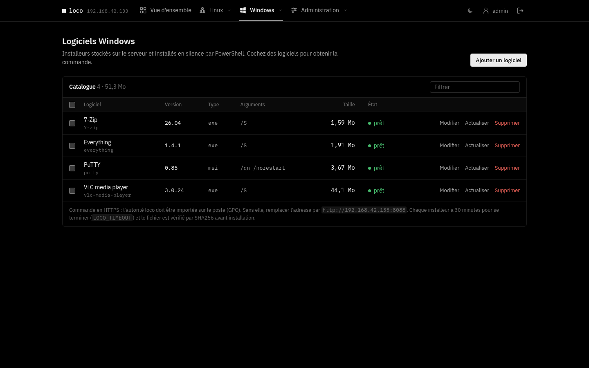
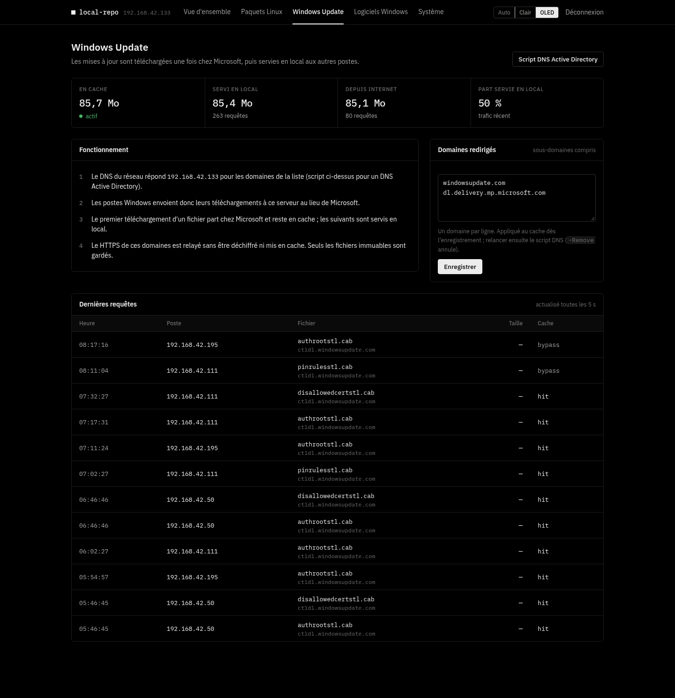

# local-repo

[](https://github.com/ShaNouhAr/local-repo/actions/workflows/ci.yml)

Serveur de dépôts et de caches pour un réseau d'entreprise, installé en une commande sur Debian, Ubuntu ou Rocky Linux
(installation native, recommandée), dans un **conteneur LXC Proxmox VE** ou avec **Docker Compose** :

- **Paquets Linux** : cache [apt-cacher-ng](https://www.unix-ag.uni-kl.de/~bloch/acng/) pour Debian / Ubuntu
  et dépôts APT signés pour vos propres `.deb`, séparés par distribution et version.
- **Famille Red Hat** : cache des miroirs Rocky Linux, AlmaLinux et EPEL, et dépôts RPM signés par
  version majeure (`el8`, `el9`, `el10`) pour RHEL, Rocky Linux et AlmaLinux.
- **Windows Update** : cache des téléchargements de mises à jour (même principe que [lancache](https://lancache.net)).
- **Logiciels Windows** : catalogue d'installeurs (`exe`, `msi`, `msu`, `ps1`) installés en silence par PowerShell.
- **Flatpak** : cache Flathub et dépôt Flatpak local signé pour les applications de l'entreprise.
- **Portail web** en HTTPS : comptes nommés, journal d'audit, supervision, sauvegardes ; thème OLED (par défaut) ou clair.

| | |
|---|---|
|  |  |
|  |  |

## Installation

### Native (recommandée)

```bash
git clone https://github.com/ShaNouhAr/local-repo.git
cd local-repo
sudo ./install.sh
```

Debian 12 / 13, Ubuntu 22.04 / 24.04 / 26.04 et Rocky Linux 8 / 9 / 10 (validations serveur en amd64). L'installation affiche l'adresse de l'interface
(`https://<ip>:8443`), l'empreinte de l'autorité de certification et le mot de passe initial du compte
`admin` (à changer à la première connexion). Le script est relançable : il sert aussi à mettre à jour
(`git pull && sudo ./install.sh`) et à reconfigurer.

Sur Rocky Linux, la même commande détecte le système et utilise DNF avec EPEL et PowerTools (8) ou CRB (9/10). SELinux reste
actif ; les contextes et les ports nécessaires sont configurés. Si firewalld tourne déjà, une règle de
service dédiée est ajoutée ; les réseaux autorisés restent contrôlés par `--allow` et `--admin-allow`.
Rocky 10 compile le cache APT depuis une version des sources Debian avec ses correctifs, vérifiée par
SHA-256 (ce composant manque dans EPEL 10). Rocky 8 compile uniquement l’indexeur `apt-ftparchive`
2.6.1 depuis les sources Debian vérifiées ; il utilise Python 3.11 pour le portail, dans un environnement
isolé. La première installation prend donc plus de temps ; les relances réutilisent les outils compilés.

Options principales (toutes : `sudo ./install.sh --help`) :

| Option | Effet |
|---|---|
| `--allow "CIDR …"` | réseaux autorisés pour les postes (défaut : réseaux privés) |
| `--admin-allow "CIDR …"` | réseaux autorisés pour l'interface (défaut : comme `--allow`) |
| `--proxy http://hôte:port` | proxy d'entreprise pour sortir sur Internet |
| `--no-http` | HTTPS seul (autorité déjà déployée sur les postes) |
| `--no-wu`, `--no-flatpak`, `--no-rpm` | sans cache Windows Update, sans Flatpak, sans famille Red Hat |
| `--tls-cert F --tls-key F` | certificat d'entreprise au lieu de l'autorité locale |
| `--backup-keep N` | sauvegardes quotidiennes gardées (défaut 3, 0 = aucune) |

### Conteneur LXC sur Proxmox VE

Sur n'importe quel hôte Proxmox VE 7, 8 ou 9, en root :

```bash
curl -fsSLO https://raw.githubusercontent.com/ShaNouhAr/local-repo/main/lxc/proxmox-lxc.sh
bash proxmox-lxc.sh                                   # DHCP, 100 Go, 2 processeurs, 2 Go de mémoire
bash proxmox-lxc.sh --ip 192.168.10.20/24 --gw 192.168.10.1 --disk 300 -- --allow "192.168.10.0/24"
```

Le script crée un conteneur Debian 13 non privilégié (Debian 12 sur Proxmox 7), choisit le stockage
(`local-lvm`, `local-zfs`…) et le pont (`vmbr0`) disponibles, télécharge la dernière version publiée
et y fait l'installation native ; les options après `--` sont celles d'`install.sh`. Il affiche ensuite
l'adresse, l'empreinte de l'autorité et le mot de passe initial. Mise à jour :
`bash proxmox-lxc.sh --ctid N --update`. Toutes les options : `bash proxmox-lxc.sh --help`.

### Avec Docker

```bash
git clone https://github.com/ShaNouhAr/local-repo.git
cd local-repo
cp .env.example .env          # réglages : LR_HOST, LR_ALLOW, LR_PROXY, LR_WU…
docker compose up -d --build
docker compose logs local-repo   # adresse, empreinte de l'autorité, mot de passe initial de « admin »
```

Même portail, mêmes fonctions et même configuration que l'installation native : au démarrage, le
conteneur applique les variables de `.env` avec `install.sh --container`, puis `supervisord` lance nginx,
apt-cacher-ng, le portail et les tâches périodiques. Le conteneur utilise le **réseau de l'hôte** (ports
8443, 8088, 3142, et 80/443 pour Windows Update) : ne pas l'associer à une installation native sur la même
machine. Les données sont dans des volumes Docker (`LR_DATA_DIR` : dossier de l'hôte pour les dépôts et
caches). Mise à jour : `git pull && docker compose up -d --build`.

L'installation native reste recommandée en production : elle confine chaque service avec systemd
(détails dans [SECURITY.md](SECURITY.md)). Docker Engine 26 ou plus récent avec Compose v2 (validé avec
les paquets `docker.io` et `docker-compose` de Debian 13).

Déploiement en entreprise (réseau, GPO, proxy, sauvegardes, supervision, LXC, Docker, dépannage) :
**[guide d'exploitation](docs/EXPLOITATION.md)**.

## Brancher les postes

Dans **Linux › Paquets APT**, créez d'abord les dépôts nécessaires : distribution, numéro de version
facultatif et nom de code (par exemple `debian/trixie` ou `ubuntu/noble`). Une future version s'ajoute
depuis cette page, sans modifier le code. Chaque dépôt a ses propres fichiers et index signés.

Les postes font confiance à l'autorité locale (`ca.crt`, déployée par GPO ou depuis la page
*Administration › Système*), puis :

```bash
# Debian / Ubuntu : dépôt local + cache APT
curl -fsSL https://<ip>:8443/linux/setup.sh | sudo sh
# … premier branchement, autorité pas encore importée (affiche son empreinte)
curl -fsSL http://<ip>:8088/linux/setup.sh | sudo sh -s -- --trust-ca
# Cache seul, sans dépôt local
curl -fsSL https://<ip>:8443/linux/setup.sh | sudo sh -s -- --cache-only

# Rocky Linux, AlmaLinux, RHEL 8+ : dépôt local elN + dépôts officiels via le cache (--epel : EPEL aussi)
curl -fsSL https://<ip>:8443/rpm/setup.sh | sudo sh

# Flatpak : Flathub via le cache + dépôt local « local-repo »
curl -fsSL https://<ip>:8443/flatpak/setup.sh | sudo sh
```

```powershell
# Windows, PowerShell administrateur : installe un ou plusieurs logiciels du catalogue
irm 'https://<ip>:8443/win/i/7-zip,vlc' | iex
```

Le script Windows vérifie le SHA-256 de chaque installeur, laisse 30 minutes à chacun (`$env:LR_TIMEOUT`)
et reconnaît les codes « redémarrage requis », « déjà installé » et « non applicable ».

Pour Windows Update, le DNS doit renvoyer l'IP du serveur pour les domaines de mise à jour : la page
*Windows Update* fournit le script pour un DNS Active Directory.

Le script Linux lit `/etc/os-release` et sélectionne le dépôt correspondant au poste. Si ce dépôt
n'existe pas, il s'arrête avant de remplacer la configuration. Les dérivées peuvent choisir explicitement
`--distribution ubuntu --suite noble`. Les sources APT sont au format deb822 (`local-repo.sources`).

**Mise à jour depuis 1.0.0** : l'ancien dépôt `/apt/` et les postes déjà branchés restent fonctionnels.
L'action *Copier vers un autre dépôt* conserve les originaux. Vérifiez la compatibilité de chaque paquet,
puis relancez le script sur les postes. `--legacy` permet de conserver explicitement l'ancien dépôt partagé.

## Administration

```bash
sudo local-repo-user list | add NOM [admin|viewer] | passwd NOM   # comptes (accès perdu : passwd admin)
sudo local-repo-backup create | list | restore ARCHIVE             # sauvegardes
sudo /opt/local-repo/remove.sh [--purge]                           # désinstallation
```

Dans un conteneur LXC, depuis l'hôte Proxmox : `pct exec N -- local-repo-user list`, etc.
Avec Docker, les mêmes commandes passent par le conteneur : `docker compose exec local-repo local-repo-user list`,
`docker compose exec local-repo local-repo-backup create`. Désinstallation : `docker compose down`
(ajouter `-v` pour effacer aussi les données).

Supervision : `https://<ip>:8443/metrics` (Prometheus) et `/healthz`.

## Architecture

| Élément | Emplacement | Port |
|---|---|---|
| Portail (Flask + gunicorn, unité `local-repo-portal`, confinée) | `/opt/local-repo` | 8089, local |
| nginx : interface et fichiers des postes (HTTPS) | `/etc/nginx/sites-available/local-repo-portal.conf` | 8443 |
| nginx : amorçage HTTP (optionnel) | même fichier | 8088 |
| nginx : cache Windows Update, relais HTTPS (SNI) | `local-repo-wucache.conf`, `modules-enabled/99-local-repo-stream.conf` | 80, 443 |
| apt-cacher-ng | `/var/cache/apt-cacher-ng` | 3142 |
| Données : dépôts, catalogue, caches | `/srv/local-repo` | — |
| Base, clé GPG, statistiques | `/var/lib/local-repo` | — |
| Configuration, autorité et certificats | `/etc/local-repo` | — |

Sur Debian / Ubuntu, les dépendances viennent des dépôts officiels (`nginx`, `apt-cacher-ng`, `python3-flask`, `gunicorn`,
`gnupg`, `flatpak`, `ostree`, `createrepo-c`, `rpm`) : les correctifs de sécurité arrivent avec `apt upgrade`.
Sur Rocky, les paquets système sont suivis par `dnf upgrade` ; le runtime Python isolé et les composants
compilés sont figés et mis à jour avec les versions de local-repo.

## Sécurité

Comptes à rôles, HTTPS, CSP stricte, CSRF, blocage des tentatives, audit, filtrage réseau, processus
confiné, dépôts signés. Détails et limites : [SECURITY.md](SECURITY.md).

## Développement

```bash
sudo apt-get install python3-flask apt-utils gnupg createrepo-c rpm
python3 -m unittest discover -s tests          # portail, dépôts APT et RPM, signatures réelles
tests/e2e.sh                                   # bout en bout, sur une machine JETABLE uniquement
tests/vm-e2e.sh debian-13                       # VM jetable ; nécessite QEMU, genisoimage, SSH et curl
tests/vm-rocky-server-e2e.sh rocky-8             # serveur Rocky 8 natif, SELinux et pare-feu actifs
tests/vm-rpm-e2e.sh rocky-9                     # serveur Debian 13 + poste Rocky 9, deux VM jetables
tests/vm-docker-e2e.sh                          # image Docker et docker compose dans une VM Debian 13 jetable
```

Le workflow CI lance `shellcheck`, `pyflakes` puis une VM QEMU pour chaque entrée de
[`tests/platforms.json`](tests/platforms.json) : Debian 12/13 et Ubuntu 22.04/24.04/26.04 ;
puis, pour chaque poste de [`tests/rpm-platforms.json`](tests/rpm-platforms.json) (Rocky Linux et
AlmaLinux 8, 9, 10), un serveur et ce poste : dépôt local, cache des dépôts officiels, EPEL et retrait ;
enfin le déploiement Docker (construction, poste client, recréation du conteneur, sauvegarde) et les
serveurs natifs Rocky 8/9/10 (installation, publication APT/RPM, caches, réinstallation, sauvegarde,
restauration et désinstallation avec SELinux et firewalld actifs).
Il fonctionne à chaque PR/push, chaque semaine et à la demande, avec conservation des journaux.
Les images des VM sont vérifiées par leur empreinte avant le démarrage.
Les tests couvrent la mise à jour depuis 1.0.0 sur les systèmes déjà pris en charge, la détection du poste,
l'isolation des paquets, Flatpak, une restauration et la désinstallation. Le workflow est publié et actif sur GitHub.
Historique : [CHANGELOG.md](CHANGELOG.md).

## Licence

MIT. Polices [IBM Plex](https://github.com/IBM/plex) sous licence SIL OFL 1.1
(`portal/static/fonts/IBMPlex-LICENSE.txt`).
